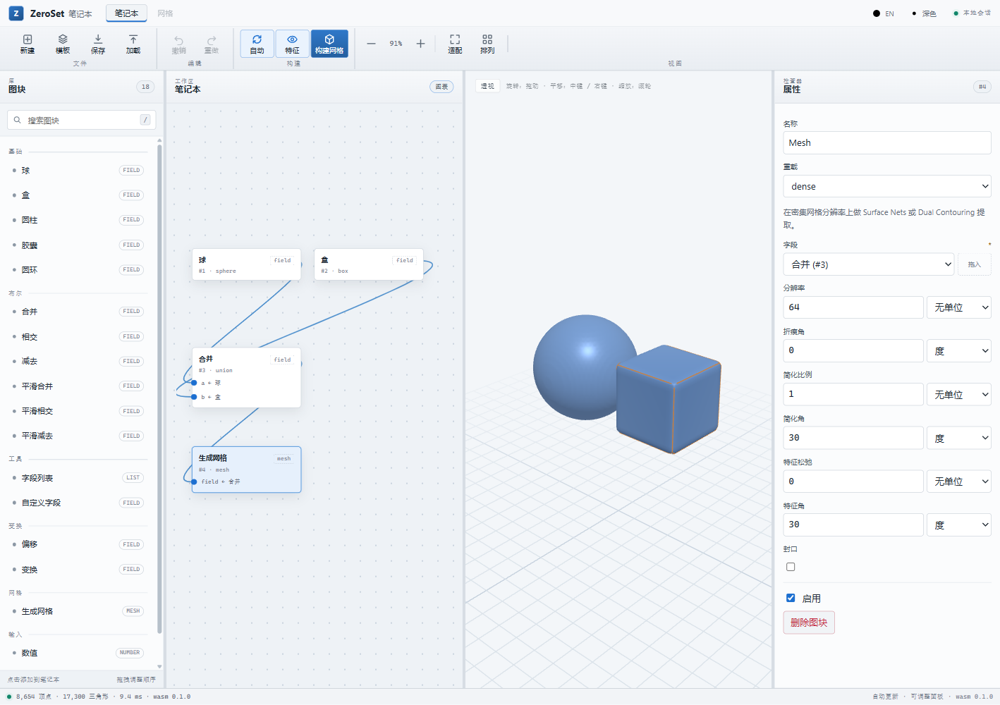
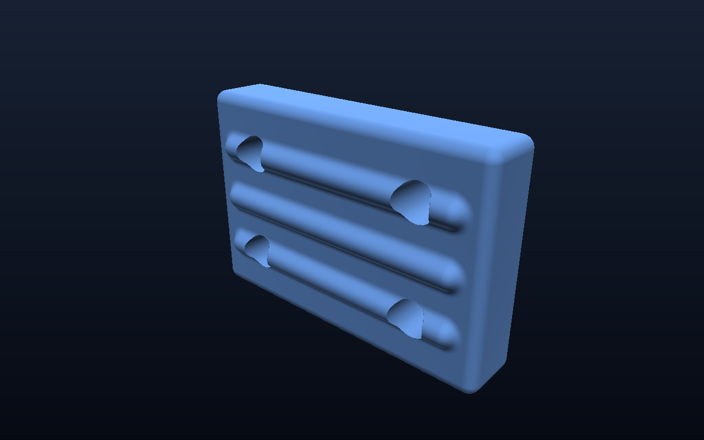
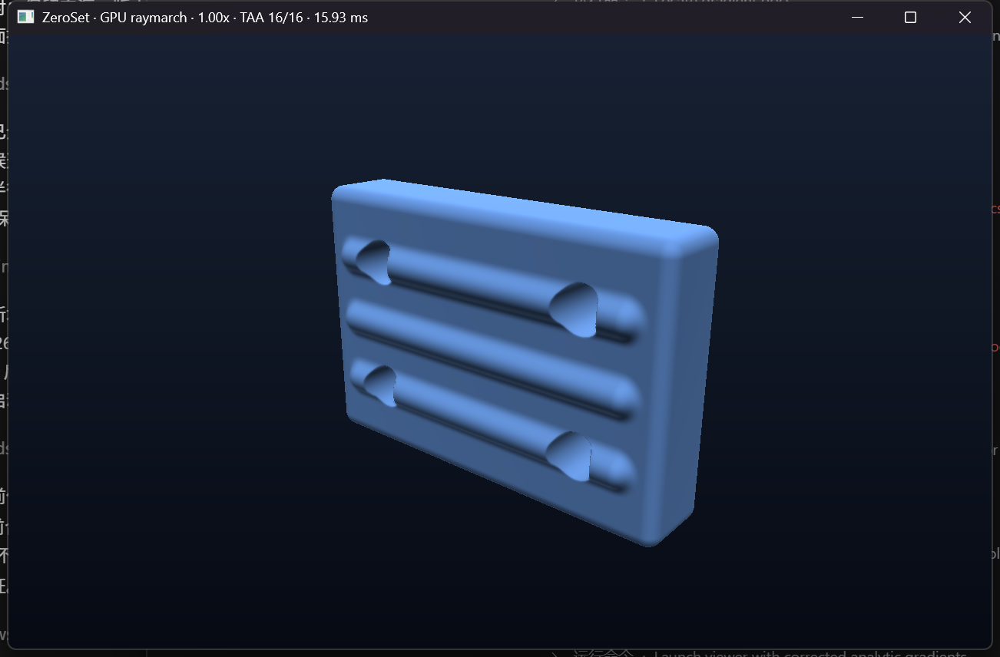

# ZeroSet Kernel · Rust + wgpu + napi/wasm

实验性隐式几何内核。与书稿 `code/` 的 C++ 参考实现并行：C++ 保持为“可读、可教学”的参考语义，这里追求“改得快、看得见、能上 GPU”。

当前版本：`0.1.0`（垂直切片，不是完整内核）。

## 已经打通

- **IR / DAG**：arena 节点表 + `NodeId`，支持共享子节点，JSON 序列化；
- **基础体**：球、圆角盒、圆柱、胶囊、圆环；
- **组合**：并/交/差、三类平滑布尔、Offset、平移/旋转/均匀缩放；
- **求值**：CPU `f32` 求值、解析梯度（球/盒/圆柱/胶囊/圆环/CSG/平滑/变换）、AABB / 类别传播；
- **精度**：`FieldGraph::rebased` 局部坐标重定基；`evaluate_f64` / `gradient_f64`（解析 + 数值兜底）/ `sample_grid_f64` + 局部 f32 或 f64 世界网格提供参考求值与提面；`Mesh::hausdorff_distance` 做 BVH 采样 golden 对拍，`hausdorff_distance_tolerance` 递归细分三角形，`hausdorff_bounds` 给出连续 Hausdorff 的保守区间；
- **采样**：带 padding 的稠密规则网格；GPU tile 批量采样；
- **动态分辨率**：GPU 八叉树自适应采样，只保留零集附近 tile；
- **自适应提面**：adaptive tile → 全局稀疏 Surface Nets，或 `mesh_adaptive_dc` 的 QEF 顶点；truncated grid 可先 refine 再 SN/DC；`mesh_adaptive_mixed` / `mesh_adaptive_mixed_dc` 用 fine-lattice edge + leaf vertex lookup 直接提 mixed-level SN/DC；`mesh_adaptive_refined_f64` / `mesh_adaptive_refined_dc_f64` 在 refined tile 上重采样 f64 并走 f64 稀疏 SN/DC；跨 tile 共享 cell/edge key，无裂缝；
- **提面**：Surface Nets + Dual Contouring/QEF + feature-edge/feature-corner 约束 + feature-adaptive 正则 + crease-aware normal split + `cap_boundary_loops` 封口 + 法向 + 闭合/边界/非流形统计；
- **特征图**：`Mesh::feature_edges(angle)` / `feature_chains(angle)` 提取 boundary 与锐边连通分量；`relax_feature_chains` 沿 crease chain 做受限 Laplacian 平滑；
- **网格处理**：`simplify_edge_collapse(ratio)` 保拓扑 QEM 边折叠（boundary + sharp quadric + feature-graph vertex lock + live edge-count boundary link condition），可传 crease angle，`simplify_clustered(ratio)` 快速聚类预览；
- **导出**：二进制 STL；
- **GPU**：DAG → WGSL 逐节点函数，wgpu compute 批量求值（Vulkan/DX12）；
- **GPU raymarch**：wgpu surface 交互视口 + headless 渲染，相机相对局部帧、逐像素屏幕空间误差、拖拽时 0.5x / 空闲后 1.0x 动态分辨率、motion-vector 重投影 TAA、16×16 tile 质量 LOD；
- **Block 层**：`zeroset-blocks` 提供注册表、类型化输入、单位、overload、状态、缓存/脏传播，字段输出是共享 `FieldGraph` 的 `NodeId`；支持版本化 JSON 快照持久化；
- **wasm**：`wasm-bindgen` 绑定 + three.js 实验台；
- **Node**：`napi-rs` 绑定 + 异步 meshing Promise API + 原生 STL/采样 demo；
- **Notebook Web UI**：wasm 驱动的 nTop 风格双栏工作台：标题栏 + 分组 Ribbon（File/Edit/Build/View）、Block 库搜索（`/` 聚焦）、自动深度布局节点画布、Properties、three.js 视口；三处分栏可拖拽调整宽度并持久化到 localStorage，窄屏按 1120/900/860/720px 逐级收缩/隐藏面板与图标文字，Library/Inspector 抽屉可从 Ribbon 打开；节点可拖拽、Shift 多选、框选、成组拖动、批量 Duplicate/Enable/Disable/Delete、Align left/top、Distribute H/V、点击连线断开、Arrange 自动布局、Features 特征边 overlay、滚轮缩放、中键/右键平移、Fit、SVG 贝塞尔连线、输出口拖到输入口、JSON 快照、Auto/Manual 更新、Undo/Redo；
- **测试**：`cargo test --workspace` 128 个测试通过（含 CPU/GPU 对拍、wasm/napi codec 与 Notebook 图测试）。



## 目录

```text
kernel/
  crates/
    zeroset-core/   # 零 GPU/FFI 依赖：IR、求值、解析梯度、采样、Surface Nets、STL
    zeroset-gpu/    # WGSL codegen + wgpu 批量/分块/自适应采样
    zeroset-cli/    # zs mesh（surface/dc，f32/f64，--compare）/ zs adaptive / sample / info / ir
    zeroset-wasm/   # wasm-bindgen 绑定
    zeroset-napi/   # napi-rs 绑定
    zeroset-blocks/ # Block 注册表、单位、Notebook 实例图、缓存/脏传播
  docs/             # nTop 界面与分辨率机制调研
bindings/
  web/              # Vite + three.js 实验台
  node/             # Node 原生包 + demo
```

## 快速开始

```bash
cd kernel
cargo test --workspace

# CPU：生成机械支架 STL
cargo run -p zeroset-cli -- mesh --preset bracket --res 64 --out bracket.stl

# Dual Contouring + f64 world grid + Hausdorff compare
cargo run -p zeroset-cli --release -- mesh --preset sphere --res 32 \
  --method dc --precision f64 --compare --hausdorff-tolerance 0.02 --hausdorff-bounds --out sphere-dc-f64.stl

# 字段诊断
cargo run -p zeroset-cli -- info --preset bracket

# 自适应 mixed-level 提面（GPU），直接写 STL
cargo run -p zeroset-cli --release -- adaptive --preset sphere --base 8 --depth 2 --tiles 12 --method mixed-dc --compare --hausdorff-tolerance 0.02 --hausdorff-bounds --out sphere-adaptive.stl

# 裁半空间并用 centroid fan 封口
cargo run -p zeroset-cli --release -- adaptive --preset sphere --base 8 --depth 2 --tiles 12 --bounds-min -1.2,-1.2,-1.2 --bounds-max 1.2,1.2,0 --method mixed-dc --cap --out sphere-half-cap.stl

# 自适应结果再做 QEM 减面
cargo run -p zeroset-cli --release -- adaptive --preset sphere --base 8 --depth 2 --tiles 12 --method mixed-dc --simplify 0.5 --simplify-angle 30 --out sphere-adaptive-simplified.stl

cargo run -p zeroset-cli -- sample --preset sphere --point 0,0,0 --point 1,0,0
cargo run -p zeroset-cli -- ir --preset bracket

# GPU vs CPU 基准（默认 128）
cargo run -p zeroset-gpu --example bench --release -- 128

# 动态分辨率 + 精度基准
cargo run -p zeroset-gpu --example adaptive --release

# 自适应窄带提面：adaptive tile → 无裂缝 Surface Nets
cargo run -p zeroset-gpu --example adaptive_mesh --release

# Dual Contouring / QEF 与 Surface Nets 对比
cargo run -p zeroset-core --example dual_contour --release

# Dual Contouring + crease normals
cargo run -p zeroset-cli --release -- mesh --preset bracket --res 64 --method dc --crease 30

# 特征图统计
cargo run -p zeroset-cli --release -- mesh --preset bracket --res 64 --method dc --features --feature-angle 30

# crease chain 受限平滑
cargo run -p zeroset-cli --release -- mesh --preset bracket --res 64 --method dc --feature-relax 2

# 保拓扑边折叠减面
cargo run -p zeroset-cli --release -- mesh --preset sphere --res 64 --simplify 0.5 --simplify-angle 30

# 聚类预览减面
cargo run -p zeroset-cli --release -- mesh --preset sphere --res 64 --simplify 0.5 --simplify-method cluster

# f32 世界坐标 / f32 局部帧 / f64 参考精度对比
cargo run -p zeroset-core --example precision

# f64 参考网格 vs f32 世界网格
cargo run -p zeroset-core --example precision_mesh

# GPU raymarch：渐进分辨率 + 屏幕空间 LOD
cargo run -p zeroset-gpu --example raymarch --release

# 交互视口：拖拽旋转，滚轮缩放；拖动时 0.5x，停手 180ms 后 1.0x
cargo run -p zeroset-gpu --example viewer --release

# Block 图：用 16 个 block 重建机械支架，导出 STL，再演示脏传播
cargo run -p zeroset-blocks --example bracket

# Notebook 持久化：保存 JSON、重载、重算、改参数再重算
cargo run -p zeroset-blocks --example persist
```

`--compare` 用 f32 Surface Nets 做基线、BVH 采样 Hausdorff；`--hausdorff-tolerance` 递归细分三角形到指定边长，`--hausdorff-bounds` 打印保守区间。sphere res 32：f32 DC ↔ f32 SN 为 **0.040123**，f64 DC ↔ f32 SN 为 **0.002593**；tolerance 0.05 时区间示例为 **[0.040123, 0.064722]**。

## Web 实验台

```bash
cd kernel
rustup target add wasm32-unknown-unknown
cargo install wasm-bindgen-cli --version 0.2.130   # 首次
cargo build -p zeroset-wasm --target wasm32-unknown-unknown --release
wasm-bindgen target/wasm32-unknown-unknown/release/zeroset_wasm.wasm \
  --target web --out-dir ../bindings/web/pkg --out-name zeroset_wasm

cd ../bindings/web
pnpm install
pnpm dev
```

`bindings/web/pkg/` 是生成物，已加入 `.gitignore`。页面是 **nTop 风格 Notebook 原型**：标题栏 + 分组 Ribbon（File/Edit/Build/View）、左侧带搜索和分类的 Block 库、中间节点画布、右侧 Properties、three.js 视口和底部状态栏；Block 库、节点画布、Properties 三处分栏可拖拽调整宽度（双击复位，宽度存 localStorage）；窄屏按 1120/900/860/720px 自适应隐藏面板/图标文字，Library 和 Inspector 可通过 Ribbon 右侧按钮以抽屉形式打开。节点可拖拽，Shift 点选/空白处框选，成组拖动，多选后可批量 Duplicate / Enable / Disable / Delete，以及 Align left/top、Distribute H/V，点击连线可断开输入，`Arrange` 会重新按依赖深度自动布局并 Fit，视口 `Features` 开关用橙色线显示 wasm 内核随 ZSM2 返回的 boundary/crease edges，阈值取自 Mesh block 的 `feature_angle`，滚轮以指针为中心缩放，中键/右键平移，Fit 自动取景；连线是画布上的 SVG 贝塞尔曲线，输出口可拖到输入 drop target/输入圆点；参数/连线修改后按 Auto 策略重建，切到 Manual 后必须点 Build Mesh；支持 Ctrl+Z / Ctrl+Shift+Z（Ctrl+Y）撤销重做；JSON 快照可保存和加载。模板是 sphere + box → union → mesh，wasm 侧通过 `notebook_template` / `notebook_eval` 暴露；结构化诊断通过 `notebook_diagnostics(snapshot, instance_id)` 返回 JSON（`severity` / `message` / `line` / `column` / `snippet` / `source` / `input`），`source` 是产生错误的 block id；UI 诊断卡显示行/列与源码 caret，点击会选中源 block 并把编辑框焦点和 caret 定位到错误处。Custom Field 编辑器带表达式预设下拉（`custom_templates()` 返回 `[{name, expression, params}]`，内置 Sphere / Scaled sphere / Offset shell / Translated sphere / Smooth union / Torus / Boolean switch 等 10 个模板），选择后替换表达式、重置并应用模板参数（如 `scale=1.5`、`offset=2mm`、`translation=(20,0,0)mm`、`flag=true`）并重建。

界面支持中英文切换和全局明暗主题：`src/i18n.ts` 管语言状态（localStorage `zeroset.language`，按浏览器语言默认，中英文词典、字段/图块/模板/单位名称和动态状态文本），`src/theme.ts` 管主题状态（localStorage `zeroset.theme`，`<html data-theme>` 和 three.js 场景/灯光/网格同步），`src/themes.css` 集中定义两套语义 CSS 变量，`style.css` 只引用变量；标题栏右侧的 `中文/EN` 和 `浅色/深色` 按钮即时切换并持久化。截图见 `ui-i18n-en-dark.png`、`ui-i18n-light.png`、`ui-i18n-1024.png`、`ui-i18n-760.png`。

## Node 绑定

```powershell
cd kernel
cargo build -p zeroset-napi --release
Copy-Item target\release\zeroset_napi.dll ..\bindings\node\zeroset-kernel.win32-x64-msvc.node -Force
node ..\bindings\node\demo.cjs bracket 64
node ..\bindings\node\smoke.cjs
```

`napi-rs` CLI 在 `F:` 盘上会卡在 filesystem reconciliation lock（已产生过大量临时文件，已清理）；当前用“cargo 编译 + 手动改名 `.node`”的方式，功能等价。换到 NTFS 本地盘后可以再试 `napi build`。

`zeroset-napi` 自带 2 个 Rust 测试，直接调用 `mesh_binary` 检查 ZSM2 magic 和 feature-angle 行为；`bindings/node/smoke.cjs` 再通过真实 `.node` 模块做加载、二进制头检查，并验证 `meshBinaryAsync` 的 Promise 路径与事件循环让步。

`meshBinary(preset, resolution, featureAngle?)` 可选第三个参数控制 ZSM2 里的 feature edge 阈值；实测 bracket res8：30° 有 106 条 feature edges，120° 为 0。`meshBinaryAsync(...)` 返回 `Promise<Buffer>`，内部用 `tokio::spawn_blocking` 把 meshing 放到阻塞线程池；smoke 中 res128 的 dispatch 为 0ms、总耗时约 106ms，事件循环在结果返回前已继续运行，非法 preset 会 reject Promise。

## 实测

机械支架，Surface Nets，64 分辨率：

| 指标 | 值 |
|---|---|
| 顶点 / 三角形 | 7,884 / 15,780 |
| 拓扑 | closed，boundary_edges = 0，non_manifold_edges = 0 |
| 有符号体积 | 27,293.87 |
| STL | 789,084 bytes |

GPU 批量求值（RTX 5080，Vulkan；bracket，128 分辨率，518,035 个采样点）：

| 指标 | 值 |
|---|---|
| GPU | 6.34 ms（约 8,170 万点/秒） |
| CPU 单线程 | 66.39 ms（约 780 万点/秒） |
| 加速比 | 10.47x |
| max \|CPU-GPU\| | 4e-6 |
| mean \|CPU-GPU\| | < 1e-6 |

这些数字只代表当前机器和当前 DAG，不作为承诺；它们说明“CPU 求值 + GPU 求值”两条路径已经可用且数值一致。

GPU 自适应采样（bracket，`base_cells = 16`，`band_cells = 2`，RTX 5080 / Vulkan）：

| depth | 有效 tile | 采样点 | 同分辨率全网格点 | 稀疏比 | 耗时 |
|---|---|---|---|---|---|
| 3 | 128 | 628,864 | 2,146,689 | 3.41x | 56 ms |
| 4 | 540 | 2,653,020 | 16,974,593 | 6.40x | 120 ms |
| 5 | 2,756 | 13,540,228 | 135,005,697 | 9.97x | 515 ms |

自适应窄带提面（同一份 adaptive tile，Surface Nets 使用全局 cell/edge key）：

| depth | tile | 采样点 | 顶点 | 三角形 | closed | boundary edges | 体积 | 采样耗时 | 提面耗时 |
|---|---|---|---|---|---|---|---|---|---|
| 3 | 128 | 628,864 | 32,780 | 65,572 | true | 0 | 27,439.33 | 69 ms | 325 ms |
| 4 | 540 | 2,653,020 | 131,940 | 263,892 | true | 0 | 27,468.69 | 124 ms | 1.57 s |

这里的“无裂缝”来自统一 cell size + 全局 cell/edge key：相邻 tile 在共享边上的 quad 会引用同一批 cell 顶点，而不是各自生成 T-junction。严格路径是**自适应占用 + 最细层统一分辨率**；`mesh_adaptive_mixed` 则用 fine-lattice edge + coarse/fine leaf lookup 做 mixed-level SN 原型。

Dual Contouring（bracket 128，analytic gradient）与 Surface Nets 对比：

| 方法 | 顶点 / 三角形 | closed | boundary | 体积 | 尖锐盒 mean \|SDF\| | CPU 耗时 |
|---|---|---|---|---|---|---|
| Surface Nets | 32,542 / 65,096 | true | 0 | 27,439.42 | 4.95e-4 | 约 9 ms |
| Dual Contouring | 32,542 / 65,096 | true | 0 | 27,476.14 | 0 | 约 170 ms |

DC 的每个 cell 用 edge crossing + 解析梯度解 QEF，再做 cell clamp；尖锐盒的顶点误差从 4.95e-4 降到 0，代价是 CPU 上约 10–20x。cell 内法向差异大于 60° 时，额外加入 feature-edge line constraint（`I - d dᵀ`，权重 `2 + 4(1-cosθ)`）；三个强独立法向再求解平面交点并加 feature-corner 约束。检测到 feature 的 cell 使用更小的 QEF 正则 `1e-4`，平滑 cell 保持 `1e-3`。sharp box res64 的 max error 从 **2.086e-5** 降到 **2.4e-7**，mean 从 **2.5e-7** 降到 **1e-8**。

```bash
cargo run -p zeroset-core --example sharp_qef --release
```

- `Mesh::simplify_edge_collapse_with_angle(ratio, crease)` 用 QEM 代价 + 最短边候选 + link condition 折叠，feature vertices/edges 直接来自 `feature_edges(crease)`；最优顶点被 clamp 在 edge midpoint 附近。boundary/sharp quadric 和 feature-vertex lock 共同约束折叠；sphere res64 ratio0.5 从 **38,460** tris 降到 **19,230**，Hausdorff（tolerance 0.05）约 **0.014318**，结果仍 `closed=true, boundary_edges=0, non_manifold_edges=0`。`simplify_clustered` 仍是预览级聚类减面，不保持流形。

`Mesh::feature_edges(angle)` 提取 boundary 与二面角超过阈值的边；`feature_chains` 做连通分量。bracket res64 DC 在 30° 得到 **1,572 edges / 36 chains**，60° 得到 **410 edges / 30 chains**，仍是 closed；CLI 用 `--feature-angle` 指定阈值。`relax_feature_chains(angle, iterations)` 只移动非 boundary、degree=2 的 feature 顶点，各向同性 Laplacian 半步长；bracket 2 次迭代后 feature graph 变为 **1,627 edges / 31 chains**，仍 closed。`cap_boundary_loops` 对简单 boundary 环加 centroid fan，可一次封多个独立环；`cap_boundary_loops_with_report` 返回 `BoundaryCapReport { boundary_edges, non_manifold_edges, branch_vertices, loops, skipped_edges }`。Notebook Mesh block 暴露 `feature_relax`（0–8 次）、`feature_angle` 和 `cap`。

`Mesh::with_crease_normals(angle)` 按面法向聚类拆分顶点法向，几何和三角形不变，只复制锐边/尖角处的顶点；bracket res64 在 30° 阈值下从 **7,884** 顶点拆到 **9,659**。Notebook 的 Mesh block 也暴露了 `crease`（Angle/degree）、`simplify` ratio 和 `simplify_angle`（Angle/degree）；模板 res64 设 `simplify=0.5, simplify_angle=30` 时从 **8,654/17,300** 降到 **4,329/8,650**。闭合性等拓扑统计仍应在拆分前的 mesh 上做。

`adaptive_mesh` 例子还演示了 truncated grid：sphere、`max_tiles = 12` 时有 14 个 mixed-level leaf，严格 `mesh_adaptive` 报错，`mesh_adaptive_refined` 得到 **4,760 顶点 / 9,516 三角形、closed=true、boundary=0**，refine 约 18 ms；`mesh_adaptive_refined_dc` 走 QEF 后拓扑不变，约 35 ms；`mesh_adaptive_refined_f64` 约 59 ms，`mesh_adaptive_refined_dc_f64` 约 81 ms，f64 DC 对 f64 SN 的 Hausdorff 约 **0.002592**。refined SN/DC 还会逐三角形按 field gradient 重新定向并重建法线，修复了多孔 CSG 上 winding 不一致导致的 signed volume 抵消（三孔板 refined SN **0.219447 → 1.535693**，refined DC **0.283532 → 1.575056**）；truncated mixed 检出 non-manifold 时也回退到该 refined 路径。`mesh_adaptive_mixed` 直接走 fine-lattice edge + coarse/fine leaf lookup，并用 gradient 统一三角形朝向：sphere **1,610 顶点 / 3,216 三角形、closed=true、boundary=0、nonmanifold=0、volume=4.121312**，Hausdorff 约 **0.008492**；`mesh_adaptive_mixed_dc` 在同一拓扑上做 feature-aware QEF，非 feature 顶点按 level + QEF/mass-point 偏移量向 mass point 混合（coarse `0.7 + 0.2*offset/cell`，fine 100%），volume **4.141012**、Hausdorff **0.006338**。truncated sharp box 的 mixed DC 为 **1,904 / 3,804、volume=7.999996、Hausdorff=0.072168**；薄壁 box **2,879 / 5,754、volume=0.3999996、Hausdorff=0.032004**；genus-1 torus **1,033 / 2,066、closed=true、boundary=0、nonmanifold=0、volume=2.283193、Hausdorff=0.024744**；truncated capsule **644 / 1,284、closed=true、boundary=0、nonmanifold=0、volume=0.544772**；truncated cylinder **1,150 / 2,296、closed=true、boundary=0、nonmanifold=0、volume=1.169305**；三孔板（uniform mixed path，`truncated=false`）**4,520 / 9,048、closed=true、boundary=0、nonmanifold=0、volume=1.599245、Hausdorff=0.072168**；把上半球 corner 值裁成正值的 open-boundary 测试得到 **804 / 1,218、closed=false、boundary=60、nonmanifold=0**；直接用裁剪后的 bounds（z ≤ 0）采样时得到 **781 / 1,516、boundary=44、nonmanifold=0**，再经 `cap_boundary_loops` 封口得到 **782 / 1,560、closed=true、boundary=0**。

`mesh_adaptive_dc(graph, grid)` 在统一 leaf cell 的 adaptive 占用上把每个 cell 的顶点换成 QEF 解，bracket depth 3 仍是 **32,780 顶点 / 65,572 三角形、closed=true、boundary=0**，CPU 提面约 1.24 s。

精度（球心在 `(1_000_000, 200_000, -300_000)`，半径 1，查询点偏移 `(0.03, -0.04, 0.05)`）：

| 方式 | 求值 | 误差 |
|---|---|---|
| f32 世界坐标 | -0.921875000000 | 7.41e-3 |
| f32 `rebased` 局部帧 | -0.929289340973 | 1.91e-8 |
| f64 参考 `evaluate_f64` | -0.929289321873 | 0 |

`cargo run -p zeroset-core --example precision` 复现。f64 路径把节点参数转成 f64，距离/CSG 全部双精度计算；f64 局部提面见下。

f64 局部提面（球心 `(1e6, 2e5, -3e5)`，半径 1，resolution 64）：

| 路径 | max 半径误差 | mean 半径误差 | 三角形 | closed |
|---|---|---|---|---|
| f32 世界 SN | 0.125977 | 0.014554 | 38,124 | true |
| f32 世界 DC | 0.075291 | 0.020401 | 38,124 | true |
| f64 世界 SN | 0.000351877 | 0.000220853 | 38,460 | true |
| f64 世界 DC | **0.000315600** | **0.000151150** | 38,460 | true |
| f64 局部 SN | 0.000352 | 0.000221 | 38,460 | true |
| f64 局部 DC | **0.000316** | **0.000151** | 38,460 | true |

`sample_grid_f64` 在 f64 下求值/求交，`surface_nets_world()` / `dual_contour_world()` 直接输出 `MeshF64` 世界坐标，`surface_nets_local(reference)` / `dual_contour_local(reference)` 则输出参考点附近的 f32 局部坐标。f64 世界网格与局部网格的半径误差相同，说明误差主要来自 resolution 64 的离散化，而不是坐标存储。

`Mesh::hausdorff_distance` 用三角形 BVH + 每三角形 1–7 个固定 barycentric 采样做近似对称 Hausdorff：

| 对比 | Hausdorff |
|---|---|
| f32 局部 SN ↔ f64 局部 SN | 0.125596 |
| f64 局部 SN ↔ f64 局部 DC | 0.000661 |

这就是“更高精度分辨率”的内核基础：分辨率提高时，坐标也跟着进局部帧，而不是让 f32 在万级坐标上硬扛；需要 golden 时再切 f64 参考。

GPU raymarch（bracket，1280×800，`max_steps = 160`，RTX 5080 / Vulkan；管线只编译一次）：

| pass | 内部尺寸 | 耗时 |
|---|---|---|
| 0.25 | 320×200 | 0.73 ms |
| 0.50 | 640×400 | 0.98 ms |
| 1.00 | 1280×800 | 4.09 ms |
| 合计 | — | 7.55 ms |



wgpu surface 交互视口（拖拽旋转、滚轮缩放、0.5x 拖动 / 1.0x 空闲）：



着色器里没有固定体素：每个像素沿射线 sphere tracing，`epsilon = max(base, t * pixel_angle)`，近处更细、远处更粗；这是屏幕空间 LOD 的第一版。`render_progressive` 先出低分辨率，再逐级到全分辨率，前两帧可以直接上屏，不必等 1.0 pass。`viewer` 例子里拖动时渲染 0.5x，停手 180ms 后自动补一帧 1.0x。

TAA 是独立 pass：raymarch 把 **forward depth** 写进 alpha，TAA 用当前相机重建命中点、投影到上一帧相机、按深度差拒绝 disocclusion，再采样 history。拖动时 `alpha=0.2`，静止时 `alpha=1/(n+1)` 累积 16 帧；目标尺寸变化时重置 history。之后每帧先跑一个 **16×16 tile 分析**：用上一帧颜色算对比度/方差，平坦 tile 降到 64 steps + 2x epsilon，边缘 tile 保持 160 steps + 1x epsilon。它是启发式 tile LOD，还不是基于深度/运动矢量的精确 LOD。

## 关键设计

**IR 是中心，后端可替换。** `zeroset-core` 不依赖 wgpu、napi、wasm；`FieldGraph` 可以在 CLI、Node、浏览器里以同一套 JSON 语义使用。

**解析梯度 + 数值兜底。** 球、盒、圆柱、胶囊、圆环、CSG、平滑布尔、Offset、Transform 都有解析梯度；奇异点和不可微位置退回中心差分。CPU 和 GPU 现在都走解析梯度：WGSL codegen 为每个节点发射 `zs_grad_*`，CSG 用分支/`select`，平滑布尔用混合权重，Transform 用 `transpose(R) * grad_local`；零长度梯度才回退中心差分。GPU probe test 在 bracket 上逐点对比 CPU，误差 < 1e-2。

**WGSL 逐节点函数。** 每个 `Node` 生成一个 `fn zs_node_N(p: vec3<f32>) -> f32`，子节点先发射；Transform 节点用逆映射点调用子函数，因此旋转/缩放不需要把矩阵烘进每个图元。

**自适应分辨率是内核级采样策略。** `sample_adaptive` 从 bounds 中心建一个立方体根 tile，按零集/窄带八叉树细分；每个 tile 固定 `base_cells + 1` 角点，分辨率每层翻倍，内存随表面积增长而不是体积。`mesh_adaptive` 把这些 leaf tile 当成一个全局稀疏 cell 集合：统一 cell size、共享 corner/cell/edge key，跨 tile 的 quad 直接连接，所以不会产生 T-junction 裂缝。`max_tiles` 截断导致混合层级时，`mesh_adaptive_refined` 会把粗 leaf 在 CPU 上重采样到最细 cell，再走同一套 Surface Nets；`mesh_adaptive_mixed` 则直接在 fine lattice 上遍历边，把 coarse/fine fine-cell 映射到各自 leaf 顶点，作为跨层缝合原型。

```rust
let config = AdaptiveConfig {
    bounds: graph.bounds(),
    base_cells: 16,
    max_depth: 5,
    band_cells: 2.0,
    max_tiles: 8192,
};
let grid = sample_adaptive(&sampler, &graph, &config)?;
// grid.reference + tile.origin 才是世界坐标
```

**局部坐标是精度策略。** `FieldGraph::rebased(reference)` 把所有绝对位置平移到局部帧，`sample_adaptive` 自动以 bounds 中心为参考。世界坐标只用于输出，不参与热循环。

**Raymarch 是视口的第一版。** `compile_raymarch_shader` 复用同一套 `zs_field`/`zs_gradient`；相机进局部帧，`resolution_scale` 控制内部渲染尺寸，`render_progressive` 复用同一条 pipeline 依次跑 0.25/0.5/1.0。屏幕空间 epsilon 随 `t * pixel_angle` 增长，所以近处表面更细、远处更粗。

**GPU 不再只做“一个平面数组”。** `sample_tiles` 一次 dispatch 批量求值多个 tile，并按 wgpu 的 65535 workgroup 限制自动分块；超过 200 万点的 pass 会拆成多次 dispatch。

**缓冲区 ABI。** 输入是扁平的 `f32` xyz 数组，输出是 `f32` 值数组；不做逐点对象。wasm 和 napi 都用 `zeroset_core::encode_packed_mesh` 返回 `ZSM2`（magic + vertices/triangles/feature_edges 计数 + positions + normals + indices + feature edge indices），JS 侧零解析成本。

**f32 热路径 + f64 参考。** CPU/GPU 使用同一 f32 精度便于对拍；大坐标模型先用 `rebased` 局部帧。`evaluate_f64` / 解析 `gradient_f64_analytic` / `sample_grid_f64` 提供双精度参考和局部 SN/DC 提面；truncated adaptive grid 现在有 f64 稀疏 SN 与 f64 QEF DC 路径。

## Block 注册表 / Notebook

`zeroset-blocks` 是 nTop 式前端的后端地基：

- **BlockDef**：id、名称、分类、描述、多个 overload；
- **InputDef**：名称、`ValueType`、是否必填、`UnitKind`、默认值；
- **BlockInstance**：稳定 `InstanceId`、参数、输入连线、enabled/manual、状态、诊断、缓存输出；
- **单位**：长度以毫米为 base（cm/m/inch 可换算），角度以弧度为 base（degree 可换算），vector 也带单位；
- **类型检查**：Field / Mesh / Number / Vector / Boolean / Text，不匹配就报 `TypeMismatch`；
- **overload**：`sphere` 支持 `radius` / `diameter`，`union` 支持 two / three / list，`mesh` 支持 `dense`（Surface Nets）/ `dual_contour`（QEF），并有 `resolution` / `crease` / `simplify` / `simplify_angle` / `feature_relax` / `feature_angle` / `cap` 参数；
- **状态**：Unbuilt / Built / Warning / Error / Disabled；
- **缓存/脏传播**：改参数或连线只把该实例及下游标脏；未变时直接返回缓存的 `Arc<Mesh>`；
- **共享 FieldGraph**：字段 block 把节点追加到 Notebook 的 arena，输出是 `NodeId`；组合不会复制子图；
- **节点回收**：`FieldGraph::compacted(roots)` 只复制从 roots 可达的节点并返回旧→新 id 映射；`Notebook::compact()` 从所有缓存输出收集 field 根（含 List 内部），压缩后重映射 `FieldHandle`，回收改参数后遗留的孤儿子图，缓存输出保持有效；
- **List 输入**：`list` block 在三种静态 overload（2 / 4 / 8 个可选 field）之外支持**自由端口**：快照和求值按实例保存任意端口名和连线，UI 可 `＋ add field` 动态加口、逐个 `Remove`、重命名端口并按 ↑/↓ 调整顺序；`union` 的 `list` overload 消费 List 做多路 union；
- **Custom Field**：`custom` block 用小型表达式编译器构建字段，支持 `def`、函数体 `let`、field/number/vector `let`、`$var`、算术/比较/`and`/`or`/`not` 和 lazy `if`；四个可选 field 输入 `a`–`d` 以 `$a`–`$d` 引用（如 `union($a, offset($b, 20))`），UI 还可动态添加任意 field 端口（如 `in1`）并以 `$in1` 引用；可选 Number 输入 `scale`（无单位）和 `offset`（长度）以 `$scale`/`$offset` 绑定（如 `offset(sphere(0,0,0,mul(10,$scale)), $offset)`），可选 Vector 输入 `translation`（长度）和 Boolean 输入 `flag` 以 `$translation`/`$flag` 绑定（如 `if($flag, sphere($translation, 10), box(0,0,0,4,4,4,1))`），连线或参数都按单位换算后绑定；`let`/`def` 参数会遮蔽同名绑定；解析错误带行/列和源码 caret，UI 用等宽多行编辑框并在 Properties 下方渲染结构化诊断（severity/行/列/snippet/caret）；Rust `Diagnostic` 同时带 `line` / `column` / `snippet` / `source` 字段，wasm `notebook_diagnostics` 输出 JSON 供 UI 消费；`custom_templates()` 暴露内置表达式模板及其参数预设（`[{name, expression, params}]`），UI 提供预设下拉并在选择时重置/应用 scale/offset/translation/flag；
- **持久化**：`NotebookSnapshot` 保存版本、`next_id`、实例 id / def / overload / 参数（含单位）/ 连线 / enabled/manual；不保存编译输出和 graph 节点，重载后重新求值。

```rust
let mut notebook = Notebook::new();
let sphere = notebook.add_block("sphere", "Sphere")?;
notebook.set_param(sphere, "radius", ParamValue::number(10.0, Unit::Millimeter))?;

let mesh = notebook.add_block("mesh", "Mesh")?;
notebook.set_input(mesh, "field", sphere)?;
notebook.set_param(mesh, "resolution", ParamValue::number(64.0, Unit::Unitless))?;

let value = notebook.evaluate(mesh)?; // Value::Mesh(Arc<Mesh>)
```

`cargo run -p zeroset-blocks --example bracket` 用 16 个 block 重建了和 preset 相同的机械支架（7,884 顶点 / 15,780 三角形），然后改圆角半径，验证下游 mesh 被标脏并重建。

`cargo run -p zeroset-blocks --example persist` 演示 4 个 block 的 union + mesh：写出 `notebook-demo.json`（1.8 KB），重载后重算出相同 15,084 三角形，再改半径得到 14,940 三角形。快照里的单位是显式的（例如 `"millimeter"`），实例 id 和连线保持不变。

## 已知限制

- `mesh_adaptive_mixed` 已能直接产出 mixed-level SN，`mesh_adaptive_mixed_dc` 在同一拓扑上做 QEF；但还没有 mixed-level feature-edge/corner 约束；`mesh_adaptive_dc` 仍要求统一 leaf cell；
- 特征图已能提取 boundary/crease edges 和连通链，驱动 QEM feature lock，并做 degree=2 的受限平滑；但还没有跨 cell 的 feature-line 传播；
- 视口 Features overlay 使用内核 `feature_edges(feature_angle)`，随 ZSM2 传输；napi `meshBinary` 也走同一 codec，并可传第 3 个 featureAngle；
- Mesh block 的 `crease` 参数是 Angle/degree；Notebook UI 的参数 unit 字段已修正（之前读错 `unit_kind`，所有单位显示成 unitless）；
- `simplify_edge_collapse` 的 QEM 最优解会 clamp 到 edge 附近；boundary/sharp quadric 和 feature lock 是启发式；edge 计数索引仍是每 collapse 更新，未做空间 BVH；`simplify_clustered` 不保持流形/边界/锐边；
- `mesh_adaptive_mixed_dc` 已有 feature-edge/corner 约束、gradient 朝向修正和 offset-aware mass-point 混合；sphere Hausdorff **0.006338** 已低于 SN 的 0.008492，volume 4.141012 比解析值低约 1.1%；sharp box / 薄壁盒 / genus-1 torus / capsule / cylinder 均闭合并保持体积，open boundary 能正确报告 boundary edges，`cap_boundary_loops_with_report` 可封简单边界环并报告 loops/skipped_edges；复杂拓扑仍需更多回归；
- truncated 三孔板（`max_tiles=12`）的 raw mixed 输出仍有过渡区缺陷：**1,412 / 2,978、closed=false、boundary=10、nonmanifold=158**；`mesh_adaptive_mixed_dc` 在 truncated grid 上检测到 non-manifold 后自动回退到 refined DC，实测返回 **4,520 / 9,048、closed=true、boundary=0、nonmanifold=0、volume=1.574660**，因此调用方拿到的是流形表面；深层截断仍可能超出 refine 点预算；
- truncated grid 的稳定回退仍是 `mesh_adaptive_refined`；浅层截断可能超出点预算；
- raymarch 的 TAA 已做相机重投影和深度拒绝，但没有物体运动矢量（模型是静态的），也不是完整的 disocclusion 修复；
- tile LOD 用颜色对比度/方差做启发式分类，没有深度或运动矢量；
- Hausdorff 默认仍是固定采样近似；`hausdorff_bounds` 的区间依赖叶子最大边长的一半和距离函数 1-Lipschitz 性质，是保守上界，不是精确值；
- Node 绑定已提供 `meshBinaryAsync` Promise API（`tokio::spawn_blocking`），但还没有 GPU context；其余 API 仍是同步的；
- wasm 目前是 CPU 路径，尚未接 WebGPU；
- 网格统计只检查边使用次数，不检查朝向一致性和自交；
- Notebook UI 还是原型：节点可多选、成组拖动、批量操作、缩放、平移，布局仍是自动深度分层；List 已支持自由端口（动态 add/remove、重命名、↑/↓ 排序、快照往返）；Custom Field 有 lazy `if`、`and/or/not`、静态递归和 256 次上限的编译期 `for`，解析错误已带行/列+caret 并显示在 UI 诊断面板，且诊断随 Mesh 传播时保留 `source`，点击诊断卡可跳回源 block 并定位 caret；表达式模板预设与参数预设已接（选择模板会重置并应用 scale/offset/translation/flag），但仍没有带参数占位符的模板实例化、用户自定义模板保存/加载、动态条件/运行时循环。

## 下一步（按优先级）

1. **Custom Block 增强（续）**：动态 field 端口、Number 参数（`$scale`/`$offset`）、Vector/Boolean 参数（`$translation`/`$flag`）、结构化诊断全链路（含 `source` 传播与点击跳转）、10 个表达式模板与参数预设已接；继续做带参数占位符的模板实例化、用户自定义模板保存/加载；
2. **mixed-level QEF feature 约束**：给 `mesh_adaptive_mixed_dc` 接 feature-edge/corner 与更稳的正则；
3. **feature graph 驱动的 DC QEF 约束**；
4. **napi GPU + wasm WebGPU**：napi 已有异步 meshing Promise API，继续把 wgpu 后端接到两个宿主。

## nTop 调研

界面与分辨率机制的调研笔记在 [`docs/ntop-ui-and-kernel-notes.md`](docs/ntop-ui-and-kernel-notes.md)：
Ribbon / Notebook / Block 状态模型、五档 Resolution 与 Adaptive、nTop 5.0 新内核的公开信息，以及它们对 Block 注册表、视口 LOD、精度策略的具体约束。

## 与书稿的关系

- `code/`：C++20 参考实现，保持书里的接口、测试与教学节奏；
- `kernel/`：Rust 实验内核，用来快速验证第二册之后的提面、空间结构、GPU 与绑定；
- 两边共享同一套语义关键词：`FieldCategory`、`BoundsKind`、`GradientSource`、`exact/approximate/general`。后续可以加一个 CSV/JSON 对拍任务，把 C++ 的 `slice_export` 输出作为 golden。
